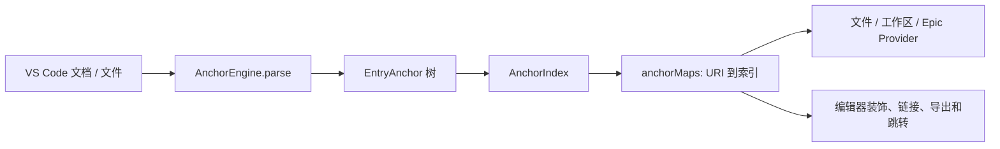

# Comment Anchors 源码阅读教程

本文面向想了解实现、排查问题或参与贡献的开发者。项目是一个 VS Code 扩展：在注释或字符串中识别配置的标签，将匹配结果缓存为锚点，再展示在侧边栏、编辑器装饰和可点击链接中。用户功能说明见[中文使用文档](README.zh-CN.md)；本文重点讲代码从哪里读、功能怎样串起来。

> **阅读建议：**先沿着“扩展启动 → 解析 → 缓存 → 展示”读一遍，再按自己关心的功能深入。核心解析和状态管理集中在 `AnchorEngine`，因此建议把[引擎实现](src/anchorEngine.ts)作为主要入口。

## 1. 先看项目如何启动

先看[扩展清单](package.json#L23-L131)中的命令、视图声明和配置，再看[激活入口](src/extension.ts#L18-L35)：清单里的 `main` 指向编译产物，扩展在启动完成后激活；`activate()` 创建一个 `AnchorEngine`，并把 VS Code 命令绑定到命令函数。扩展清单中的视图 ID（`fileAnchors`、`workspaceAnchors`、`epicAnchors`）会在引擎构造时对应到不同的树视图提供器。

`AnchorEngine` 的[构造函数](src/anchorEngine.ts#L163-L232)会订阅活动编辑器、文档变化、配置变化等 VS Code 事件，创建三个侧边栏视图和文档链接提供器，最后调用 `buildResources()`。因此，想了解“启动时为什么做了这些事”，可以从 `activate()` 跟到构造函数，而不是先从 UI 提供器开始。

## 2. 牢记主数据模型

解析结果不是直接写进侧边栏，而是沿着下面这条链路传递：

- `AnchorEngine` 管理配置、匹配器、缓存、视图和扩展状态，是功能协调中心，见[引擎字段与构造](src/anchorEngine.ts#L57-L232)。
- `EntryAnchor` 表示一个锚点，包含标签、显示文本、位置、范围、文件 URI 和属性；它也负责计算装饰范围、子项和跳转命令，见[锚点条目](src/anchor/entryAnchor.ts#L9-L150)。
- `EntryAnchorRegion` 继承普通锚点，增加结束标签、折叠范围及子锚点，见[区域锚点](src/anchor/entryAnchorRegion.ts#L9-L89)。
- `AnchorIndex` 保存一份文件的锚点树，并构建按显示文本查找的索引，见[文件索引](src/anchorIndex.ts#L1-L37)。引擎通过 `anchorMaps` 将文件 URI 映射到 `AnchorIndex`。
- 锚点树需要按场景展平时，使用 `flattenAnchors()`，见[树形锚点展平工具](src/util/flattener.ts#L1-L20)。

区分“文件内锚点树”和“跨文件缓存”很重要：区域锚点的子项仍保留在树中；工作区视图、Epic 聚合、链接和导出等功能可以按需遍历或展平它。

## 3. 从配置生成规则，再解析文件

### 3.1 配置如何变成标签与正则

`buildResources()` 是配置汇总点，见[资源构建与匹配器生成](src/anchorEngine.ts#L250-L606)。它读取 `commentAnchors` 配置，注册默认标签、合并自定义标签，准备图标与文本装饰，并根据标签、前缀、分隔符等设置构造正则匹配器。

- 默认标签及各自的 `scope`、`behavior` 在[默认标签表](src/util/defaultTags.ts#L1-L83)，例如 `SECTION` 是区域类型，`LINK` 和 `LINKS` 是链接类型。
- 用户定义标签的合并、禁用和旧配置兼容逻辑在[自定义标签解析](src/util/customTags.ts#L1-L47)。
- 对照[扩展清单的配置定义](package.json#L131-L380)阅读，可确认设置项的默认值、类型和描述。

### 3.2 `parse()` 如何构造锚点

核心解析位于[`parse()`](src/anchorEngine.ts#L808-L1002)，建议按以下顺序阅读：

1. 用 `workspace.matchFiles` 检查目标文件是否匹配；优先读取已打开文档的缓冲区内容，否则再读取磁盘文件。
2. 循环执行引擎构建的正则，取得标签、可选属性和说明文本，并计算锚点的行号与字符范围。
3. 通过 `parseAttributes()` 解析 `id`、`epic`、`seq` 等属性；没有显式序号时，默认使用锚点所在行号，见[属性解析](src/anchorEngine.ts#L765-L805)。
4. 普通标签创建 `EntryAnchor`；`behavior: "region"` 创建 `EntryAnchorRegion`。区域起始项压入栈中，后续锚点挂到当前区域之下；匹配结束标签时补上结束位置并弹栈。
5. 将根锚点封装成 `AnchorIndex`，写入 `anchorMaps`。

`EntryAnchor` 的构造函数会设置侧边栏点击后的跳转命令；`EntryAnchorRegion` 的 `setEndTag()` 则补齐区域终点。这样解析阶段建立的数据结构，同时也是树视图和跳转行为的输入。

### 3.3 编辑器变化怎样触发重解析

文档变更事件由引擎监听，`onDocumentChanged()` 将解析延迟到 debounce 计时后执行，避免每次按键都立即扫描；活动编辑器切换时会确保对应文件进入缓存。相关入口见[文件映射与编辑器事件](src/anchorEngine.ts#L1082-L1195)。解析完成后由 `refresh()` 更新装饰、链接事件和侧边栏，见[视图刷新](src/anchorEngine.ts#L1013-L1080)。

## 4. 按功能追踪核心代码

### 文件锚点侧边栏

[文件视图提供器](src/provider/fileAnchorProvider.ts#L12-L89)实现 VS Code 的 `TreeDataProvider`：从当前编辑器对应的 `anchorMaps` 项取根锚点，过滤隐藏项、按设置排序，并在需要时插入光标位置。树节点本身是 `EntryAnchor` 等 `TreeItem`，点击行为由条目设置的命令执行。

### 工作区扫描与工作区视图

手动扫描命令最终调用 `initiateWorkspaceScan()`；它通过 `workspace.findFiles()` 获得文件，再交给 `loadWorkspace()` 逐个调用 `addMap()` / `parse()`，并周期性让出主线程。实现见[工作区扫描与加载](src/anchorEngine.ts#L607-L690)。扫描命令绑定位于[命令实现](src/commands.ts#L14-L20)。

[工作区视图提供器](src/provider/workspaceAnchorProvider.ts#L10-L111)从缓存中按文件分组，只展示对工作区可见的锚点；`EntryCachedFile` 是文件分组节点。懒加载开关、文件匹配与排除规则、扫描数量上限由配置控制。

### Epic 分组

Epic 信息来自锚点的 `epic` 属性。`EpicAnchorProvider` 遍历缓存的锚点树，将相同 Epic 的条目聚合后按 `seq` 排序；其 `getChildren()` 负责构建 Epic 视图，见[Epic 视图与补全](src/provider/epicAnchorProvider.ts#L24-L177)。属性的语法和默认值可结合[属性解析](src/anchorEngine.ts#L765-L805)理解。

### 区域层级

区域匹配也在[`parse()`](src/anchorEngine.ts#L808-L1002)中完成：起始标签进入区域栈、普通锚点成为区域子节点、结束标签闭合当前区域。区域条目的子节点和结束装饰在[区域条目类](src/anchor/entryAnchorRegion.ts#L9-L89)中实现；文件树和其他树提供器再根据子节点构造层级。

### 编辑器高亮和图标

标签的装饰类型在[`buildResources()`](src/anchorEngine.ts#L250-L606)里按配置创建；`refresh()` 从当前文件的锚点树收集装饰范围，然后调用 VS Code 编辑器 API 应用样式，见[刷新实现](src/anchorEngine.ts#L1013-L1080)。具体锚点范围由[`EntryAnchor.getAnchorRange()` 和 `decorateDocument()`](src/anchor/entryAnchor.ts#L73-L94)提供。

### 链接锚点

[`LinkProvider`](src/util/linkProvider.ts#L1-L149)实现 VS Code 文档链接接口。它识别 `link` / `links` 行为：前者可指向文件、行号或目标锚点，后者可在当前文件中按 ID 生成多个链接。锚点 ID 的匹配规则在[`AnchorEngine.hasAnchorId()`](src/anchorEngine.ts#L729-L731)附近；具体输入示例见[中文使用文档的链接章节](README.zh-CN.md#链接锚点)。

### IntelliSense 与命令导航

- 标签自动补全由[`completionProvider.ts`](src/util/completionProvider.ts#L1-L81)实现；Epic 自动补全由[`EpicAnchorIntelliSenseProvider`](src/provider/epicAnchorProvider.ts#L137-L177)实现。
- 用户命令（重解析、扫描、切换显示、导出、上一个/下一个锚点、快速选择）集中在[commands.ts](src/commands.ts#L1-L123)，并在[extension.ts](src/extension.ts#L18-L35)注册。
- 相对光标跳转和按锚点跳转由[`jumpToRelativeAnchor()` / `jumpToAnchor()`](src/anchorEngine.ts#L1127-L1169)实现；快捷键定义在[扩展清单](package.json#L24-L85)。

### 导出

`exportAnchors()` 根据保存文件扩展名选择 CSV 或 JSON，见[导出命令](src/commands.ts#L38-L67)；行数据的构造分别在[CSV / JSON 导出函数](src/util/exporting.ts#L1-L54)。它们读取引擎缓存，并用 `flattenAnchors()` 包含区域中的子锚点。

## 5. 推荐的源码阅读顺序

1. [package.json](package.json#L23-L131)：先弄清 VS Code 注册了哪些命令、视图和配置。
2. [src/extension.ts](src/extension.ts#L1-L35)：找出启动入口和命令绑定。
3. [AnchorEngine 构造函数](src/anchorEngine.ts#L163-L232)：了解事件、视图和资源初始化。
4. [`buildResources()`](src/anchorEngine.ts#L250-L606) → [`parse()`](src/anchorEngine.ts#L808-L1002) → [`AnchorIndex`](src/anchorIndex.ts#L1-L37)：追完配置、正则、解析和缓存。
5. [三个视图提供器](src/provider/fileAnchorProvider.ts#L12-L89)、[工作区提供器](src/provider/workspaceAnchorProvider.ts#L10-L111)、[Epic 提供器](src/provider/epicAnchorProvider.ts#L24-L135)：理解数据如何映射到侧边栏。
6. 最后挑一条功能支线：装饰看 `refresh()`；跳转看 `commands.ts` 和引擎导航方法；链接看 `LinkProvider`；导出看 `exporting.ts`。

## 6. 想修改功能时，从哪里下手

| 目标             | 建议入口                                                                                                               |
| ---------------- | ---------------------------------------------------------------------------------------------------------------------- |
| 新增默认标签     | [src/util/defaultTags.ts](src/util/defaultTags.ts)；检查标签行为如何在 `buildResources()` 与 `parse()` 中使用          |
| 增加标签配置项   | [package.json 的配置声明](package.json#L131-L380)，再追踪读取配置的引擎代码                                            |
| 修改锚点解析规则 | [src/anchorEngine.ts 的匹配器与解析逻辑](src/anchorEngine.ts#L250-L606) 和 [`parse()`](src/anchorEngine.ts#L808-L1002) |
| 修改锚点侧栏显示 | 对应的 [Provider](src/provider/fileAnchorProvider.ts#L12-L89) 或 [条目类](src/anchor/entryAnchor.ts#L9-L150)           |
| 调整链接目标语法 | [src/util/linkProvider.ts](src/util/linkProvider.ts)                                                                   |
| 调整命令或快捷键 | [src/commands.ts](src/commands.ts) 和 [package.json 的命令 / 快捷键声明](package.json#L24-L85)                         |
| 调整导出字段     | [src/util/exporting.ts](src/util/exporting.ts)                                                                         |

修改时注意沿完整数据链检查：解析结果、缓存、树提供器、刷新/装饰以及跳转或导出可能共享同一个锚点对象；只改展示层未必会改变解析结果，反之亦然。

## 7. 本地构建与检查

这是 TypeScript VS Code 扩展。项目脚本定义在[package.json](package.json#L491-L514)：

- `yarn compile`：编译 TypeScript。
- `yarn watch`：监听文件变化并持续编译。
- `yarn lint`：运行 ESLint。

扩展的命令、快捷键和设置由 `package.json` 声明；其实现位于 `src/`。阅读或修改时建议同时检查声明与实现，尤其当命令 ID、视图 ID 或配置键发生变化时。
